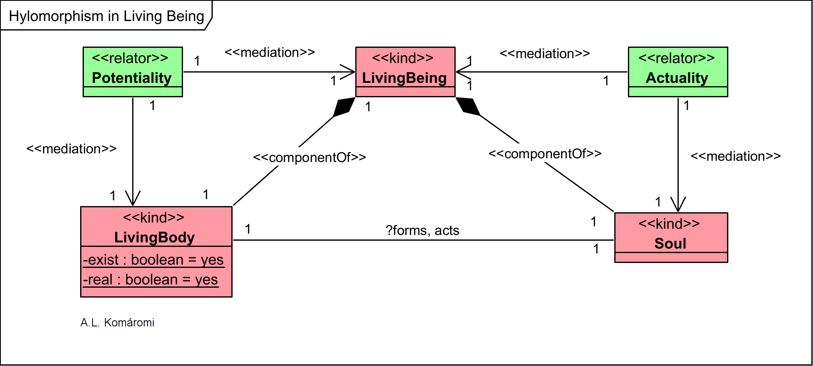

# The map of material science

From what we have listed after which the Cold War happened, it is easy to get yourself lost in the land of which material science bases itself in. Indeed of such, the phase right now of history can be considered of the proliferation of the old day material science, much to the disdain of the practitioners standing inside it. Before studying in details of what to entail of the development thereof, we might as well consider the map of material science, from the relative ancient age to the present, and settle a few definitions, operationally speaking that will evolute within times. 

## Pre-material science

The history has not been so kind to the precursors of material science on itself. During much course of histories, material science has been staying in the lane of *intriguing but disfranchising* field of accumulated research, specifically targeting certain parts of the material landscape. The definition of *material*, even up to present, is largely incoherent thereof, that it would be difficult to classify of what to be material, as some may even argue that water is a type of material, or it can be a solvent, or it can be a neutral medium. But it just so happens that the current landscape of material science, as of in the past, remains the same. The concept of material has never been given a rigorous, stable and agreed definition across the traditions that constitute materials science. The definition has changed rapidly, repeatedly, each change reflecting a different commitment, not realization, not unification or reverse calibration, but rather to about what kinds of things exist and what kinds of relations between things are scientifically fundamental, if such is even possible thereof. 

History of pre-material science can be separated into the concept word of **matter**. Before the Greek philosophical tradition formalized the concept of matter, there was already a practical concept of material that craftsmen used, shaped and transformed. Those are of the precursor materials, specifically, *bronze, iron, clay wood, flax, ivory, stone*, and so on. How do they feel of those? Specifically through *crude inference*, where one makes it so that their property is reflected by a certain metric of utilization or interaction. For example, one can say between bronze and iron, there exists a specific kind of *hardness* in contact with others, the hardness of manipulation, extraction, and sleight of handling. Cyril Stanley Smith, noted in 1968 that material is the matter of which have been through a relation toward human practice and use, most often so. This practical, relational conception of material was the implicit framework of artisans, craftsmen, and metallurgists from antiquity through the early modern period, much to the disdain of those requiring a more fundamental concept. But even so, it makes sense - matter exists as the wider universal encompassing dilemma of which everything would follow in. Even human exists of matter. Aether, luminiferous aether of the mechanical aether of sort, in which light was supposed to travel in-between, also uses the concept of matter. The Maxwell field equations specifically targetting $(\mathbf{E},\mathbf{B})$ conjunctive fields are also a form of 'matter', if we are to speak of the same criteria [^1]. The problem and difficulty there of, lies in the consequence - it means that the same substance can be simultaneously a material in one context and matter in another - it depends on the anthropological baseline of whatever using it. Such is rather very centric toward the craftsmen, but we soon realized that the world is not only us. The difficulty and the quest to find such, begins with this relational, context-dependent concept and forcing it to the becoming of being universal, of which we might as well say to be independent. We constitute the first act:

[^1]: It is of certain observation that only the concept of *material aether* was rejected. At all, the notion of aether was never refuted, but transubstantiated into a newer form.

> **Act 1.** (Baseline of utilization)
>
> Material can be defined, in difference to matter, by of which it makes sense for usage of certain actor at will. That is, if such matter is of meaning to manipulate and utilization for a certain person, then it becomes material. 

Up to another region of time, or so we speak of, Thales of Miletus regarded water as sole fundamental building block of matter, and thus henceforth also material itself.  He held that water, in taking different forms, constitutes the earth, atmosphere, sky, mountains, gods and men, beasts and birds, grass and trees, and animals down to worms, flies and ants. All these are different forms of water, and for certainty many of such different qualities inside many matter or materials, would be derivation simply by manipulating water, of which is the ability we do not possess of the time (yet). 

This constitutes the second action, the **action of fumdamentalizing derivation**. Basically speaking, this requires the think that there exists, out of all set $\{\mathrm{Ma},\mathrm{Me}\}$ for material and matter of arbitrary choice on classification notion (where we can still take the anthropological definition for material), to have certain *initial form* that would make up literally everything else in existence, just with more details or more complex types. That is, the *minimal framework* itself. It is understandable how Thales would have thought of such - consider water, a *fluid* as we know of now, where shape can be transformed, the basis of life and what human (anthropological basis, mind you) cannot live without, the solvent of many processes, medium for many mechanical or proto-chemical purposes. All of such constitutes to the big picture of that water is fundamental, and we cannot really fail that to a given degree of sort. 

> **Act 2.** (Fundamentalization of derivatives on initials)
>
> Material can be considered a set of **matter**, or rather, the set of all manipulable and utilized matter of interest, where its origin is fixated to become from an initial point or an initial starting substrate, for which derivations of such substrates are used to explain the classification thereof. 

The problem with Thales's choice - water - however, is immediately visible. If water is the fundamental substance of all things, then the water being drunk, the water that is flowing in a river, the water sitting in a bowl, the water flowing in rivers, all of which would be equally *material* in the most basic sense, it serves the purpose of being the functionally invariant structure. But what about iron or any form of *metals*? Iron cannot be water in any obvious sense. True, that up to now molecular structures can be recombined, and perhaps we can use them to make iron, but that is still excruciatingly hard, and most of the time not even worth the time to do such. Thales must have held that iron is somehow a transformation of water, water to be in a very different form. This means transforming the definition of water to be distant from its normal usage, to something of which is not water but the description of *fluid*, that is, 

> The underlying substrate that can take many forms, one which looks like what we call water. 

But this then fails when you encounter oil, or anything of such form. At that point, you have proliferation of origin - what to be called as the initials, oil or water? A sidestep can also happen if we get the Second Thales of Miletus - regarding a substance $X$ to be the unified form of which iron can be made of its derivation. But it just so happens that there are also many forms of things that look like iron, but does not act like iron in any form. This again, means pluralism of definition and the redefinition stack of which will dilute the meaning of the origin to be said of. 

Coincidentally or not based on our projection, this is the first appearance of a pattern that will recur throughout the entire history - the concept chosen as fundamental for "material" turns out to require extensive redefinition in order to accommodate everything it needs to accommodate, until the word means something quite different from its ordinary usage, while the ordinary usage remains operational in practice alongside the philosophical redefinition. Beside from confusion, it also incurs the cost - of which to ask *exactly where are you going* toward, of those redefinitions until oblivion? Such is rather hard to answer, in which because partly of the form to base anything to be fundamental, incurs also the uncertainty that there might be the *more fundamental point* that disarm what we have been doing, right above. In fact, Anaximenes substituted air for water; Heraclitus, fire. Empedocles proposed all four — earth, water, air, and fire — as irreducible elements. Aristotle based his argument chiefly on the analysis of "becoming" or substantial change. Those are also pluralism, but now in the concept of *elements* - different categorization of substrates, of which is rather antique but intuitive, and thus giving such the baseline for which all would follow. The argument of Aristotle is also interesting. He based his argument chiefly on, paraphrased,

> If $A$ is converted to $B$ of a process $T(\cdot)$, then there **must exist** something of common between them, without such no conversion can be done. 

This is presupposing the atomic theory, in which we know that atoms, and many small sub-partitions thereof are responsible for such allowance of transitions as the 'reference point fundamental substrate', so to speak. But so far, those elements are still categorization of which cannot be measurable of manipulable properties. How do you quantify 'wetness' of water? Similarly to fire, how do you quantify the 'fireness' of certain elements, if they are to be derived from such? Can iron be only earthen being with certain amounts of some elemental form elsewhere? Not quite so, and indeed not so trivial. Even if in the set of no transformation, but merely successions by the annihilation of the first term - $A$ subjects - and the creation of the second - $B$ objects - it is still probable of such fact to say it relies less on the property baseline indicted upon. Those are *external labels* that we made ourselves, much to the disdain of people of the time, simply is not enough, even if it is thermodynamically interesting, anticipating something like a property-space description of phases. But in all, they are not sufficient, and one can find the breaking point anywhere one shall like to do so, and no one would be able to answer within the box of which those are to be accepted of. However, his point about conversion is right up to a certain point. Two objects in existence that are *transformed* from one to another, posits the fact that they are somewhat connected enough that you can morph one to another, so it means, basically that $A$ and $B$ must have something in common, no matter how small it is or weak it can be. This applies to also matter - you cannot transform water to iron because at the fundamental ordinary frame, they have nothing in common aside from being 'of existence and interaction'. But, there will *always* be the common point - the word existence themselves. What lies after we crumble all of those objects? In one way or another, against such question, most philosophers and those of thoughts at such time, turned to *hylomorphism* as their saving grace. 

### In-detail - the Aristotle's Hylomorphism

Per the subject topic, of which more philosophical than not, in @Ainsworth2016FormMatter it was to be said that Aristotle's hylomorphism is rather advanced for its time. THe philosophical doctrine of such posits that all physical entities are compounds of **matter** (*hyle* - the material constituent or potentiality) and **form** (*morphe or eidos - the structure essence or actuality*), to explain of the material and the world. 

{fig-align="center" width="80%"}

The notion is toward what are essentially **compositional thought**, for Aristotle of his general ideas. Aristotle defines matter as to be 'out of which' something is made. For example, letters are the matter of syllables. Thus, matter is a relative term: an object counts as matter relative to something else. Clay is matter relative to a brick because a brick is made of clay, at that specific point, whereas bricks are matter relative to a brick house. Change is analyzed as a material transformation, for where matter is what undergoes a change of form. In all, it is also the *relational composition* that marks the strength of this approach, and perhaps even now this line of thought has only been refined, much not disappeared entirely, because of the act it allows that would be central to pretty much the *way down toward atomic scale*, and so on.

> **Act III**: We presuppose matter to be *relative*, such that $A$ is mater to $B$, if $B$ is made of $A$. Thus, matter notion are *compositional*, and at such *relational* to a given degree. 

Such relational definition of matter is rather philosophically sophisticated, if one is to claim such, which is fair for what it is worth of. For Aristotle, "matter" is not a name for some particular stuff as opposed to Thales's thesis - but rather of the *relation* between objects of being. $X$ is the matter of $Y$ when $Y$ is made from $X$. This means the same stuff can be simultaneously matter, of a statue, and something that itself has matter, relative to copper and tin. There is no ultimate substratum - or if there is, of which rather an effort of such to be *prime matter*, it is also indeterminate as to be philosophically contentious (no one wants to seriously debate that again, for all it's worth of). 

The hierarchical, level-relative concept of material bears a striking, but not so surprising resemblance of structures to the multiscale architecture of modern materials science. At each level of the hierarchy, there is something that functions as matter to be the *lower level*. Then, there exists something that functions as the form binding in which makes those lower levels higher. It does not say much about what constitute the higher layer - there can be many and of extremely complex form for all the practitioner would care for, and it would still be there of the indeterminacy of such. Each level has its own characteristic form, and the explanation of properties at each level invokes the form at that level, not the form at lower levels. 

Speaking of such, then why this is not utilized now? It seems that the theory can be adapted, much more general than it can be of any, which is a nice thing to have. Changing the context, and such would be complete as for a new modern explanation? Unfortunately, Aristotle's commentators and thereof of himself, have been struggling with a quite non-trivial set of tensions, all of which testimony has been made that the structure is unstable on itself. For this, even if we ignore one of the fundamental problem of such that can be avoided by directly supervising the structure on the precision of mathematics - which would organize his anticipation of the structural-property relationship, there are still many forms in which the problem pervades of what to be presented of. 

1. Firstly, Aristotle thinks of such as that,  if one pursues this hierarchy of matter far enough downwards, Aristotle believes that one will reach the four elements. The *presupposition* of the four elements is simply false and conditioned of the knowledge of the time. Even if right now we presuppose one for convenience, what can we even do? There exists no determinated origin point of which we can say where will we reach. Such is to abandon the *prime matter* itself, but that begs the question of how far can we go down? 
2. The theory still retains its **ontological paralysis**. Even if now we have been saying of the relational structure to be quite as good as it can be, the structure is paralyzed under its own statement. Suppose that $X$ is made of $A,B,C$. Similarly, $Y$ is made of $A,B,D$. Both $X,Y$ are variations of the same copper linage, or steel, which itself is currently known as a compound. By such, the lower level of $\{A,B,C,D\}$ contains two set of matters overlapped to give two current-layer subjects. However, they are the same under certain categorization scheme. How should we quantify this? How much of $D$ can be settled of its form in this setting, for example? When they function in the same way, used the same way, approximately having the same setting and relational utilization to the being in usage - the anthropological baseline - what to be separated from them? Similarly, if two objects are inherently different, even though they use the exactly same set, full set of matters of which are lower-level of such, how do you compare them and distinguish them? This requires adding more information, but that might also expand if you proliferate into more complex settings, more difficult distinguishment and characterization regime, until you have quite a mess. What can we do under such? 
3. Another tension, which have been there for a long time now, is the naturalness of the relationship between form and matter. Is the form just accidentally related to the matter, or it is essentially related to it? Can we remove it or replace it and the 'matter' afterward still be legitimate? The system and its frame are simply too big and too generalized, that it fails even its own test. The same structure even appears in modern materials science. The question of whether form is essential or accidental to matter is precisely the question of whether a material is defined by its composition or by its processing history. Carbon can be graphite or diamond, same matter different form, where the form is not merely accidental, but neither is the form essential to the carbon in the sense that carbon must take one form rather than another. Carbon materials can be just carbon materials, with its orientation changed, and nothing would break. Aside from the diamond. 

To pull this out apart, we might as well turn our attention to the **Scientific Revolution**, and the subsequent **Industrial-Chemical Revolutions** for their insights. But let us summarize what have been observed of the all three failures, and possibly more if one wants to look enough to the picture. 

#### Peaking - The Medieval Elaboration

Of the long-time of the Medieval period, scholasticism inherited of Aristotle through Arabic translation, primary through Avicenna and Averroes, elaborated hylomorphism into an intricate theological and metaphysical system. Those using the concept frequently distinguished between substantial form and accidental form, if one can even distinguish such from the description that is poorly operated of. For Thomas Aquinas, he argued that everything in the natural world is created by God and has specific purpose, which is revealed though both divine revelation, or natural philosophy. Such is rather characteristic of the Christian thought centred around which there are god to be, but also to set a baseline that would be rather biased, as far as we know of the present - it presupposes the purpose as already defined, of what claimed to be relational. Which is, in certain form, contradiction of sort. 

Nothing much can be said about this part more than this, unfortunately. The distinguishment scheme is rather deliberate but flawed, for example, 

> A substantial form is what makes a thing the kind of thing it is — for a piece of bronze, its substantial form is what makes it bronze rather than tin or lead. An accidental form is a property that the thing has but could lose while remaining the same kind of thing — the shape of a bronze statue is accidental, because the bronze can be melted and recast without ceasing to be bronze. 

Even if such to be extended far beyond of all creations, said statement is simply unwarranted of its determination. Tin, lead, bronze, are those that would be subjected to label, of different characteristics and structural properties in determining such. However, the determination is not discrete, there can be bronze-with-a-bit-of-tin, or bronze but designed to be at certain point, still the same substrate, but now similar to copper. And so on. Accidental form is easily to see, the shape is *accidental*, but also making contradiction - it can be melted, it can be into liquid form, but then would the extracted form being accidental? Why bronze just not appear in life as to be the melted form or a big blob? By then, what is even accidental anymore? 

### In-detail - the Mechanical and Chemical Revolution

Of the mechanical and chemical revolution, due of the 18th century to the down of the 19th century, a series of landmarks *patents* and *researches* were made, given the way possible of what there is to be the material science in the new dawn age. The two landmarks of the biggest kind can be served as present. 

- The 17th Century foundation of the **mechanical philosophy** of Descartes, Gassendi, Boyle, and Newton performed a philosophical operation on the concept of material, that has shaped material ever since. We cannot truly comprehend of what the consequences are, but it would like to be thought of still being worked out, even by modern mechanisms. There are many concepts evolved of the time, for Boyle to be *individual bit* or *formational characteristics*, of size, shape, orientation, order and textures, being matter completely passive and inert. For Descartes, the notion of *duality* took place, for where there exists again the *inertness* of the subject matter, then comes the exclusion of all *psychic characteristic* of which earlier of history being framed to be material nature, and forces physical nature to be inert and devoid of sources of activity on its own - such distinction is rather very strong, and legacy of such thought remains in the entire body of physics still of present.

In such, would rather to be said, the theory that we know right now of the **Newtonian mechanics**, bears the most responsibility of the transition. Newtonian physics, in general, inherited and fleshed out positions of Boyle, and Descartes, of which to be the physical reality being acted upon, for those mechanical philosophies stated imply the advocation of **corpuscular structures**, and *microstructure constitution*. In retrospect, individual 'small parts' arrange themselves into corpuscular structure that gives a substance its various properties. Different corpuscular structure account for different substances and different properties. As far as we consider, Boyle's corpuscular theory is, an second early version, after Aristotle's, of the **structure-property relationship**, where the microstructure of the corpuscles determines the properties of the bulk material. While mechanical in nature, as it relies on size, shape, arrangement, motions - replacing form by geometry - essentially [^2], it is still a granted substantial contribution, for the elimination of any teleological or dispositional explanation from material science. Matter now does not have indicted meaning of the higher-order being, nor the existence thereof for such matter to be *aware*, as for it to gain purposes. But rather, it makes due of what there is, for which components it shares of existence in the form of becoming. 

[^2]: It is good to stop and note that, even of the current form, the philosophical question of what to be the **form** of the object is still under heavy debate. Though, as it currently stands, it would be a nice change of pace to stop and transfer it to another framework itself, rather than sticking to such term. 

Newtonian physics patched up the operational ideal of such form separation by co-author (post-instantiation, in one way of speaking), by removing the object from its force. A force is *exerted*, and of its foundation if none of such force are at present, the state of the object simple stays the same, so to speak. The object becomes *potential* of what to be the properties and dynamics that follows, thus before any interaction can be made, they are effectively of the expression, to be decoupled from such. It also foreshadows an aspect - to truly see properties of object, there exists the requirement of *interaction per specification*. 

